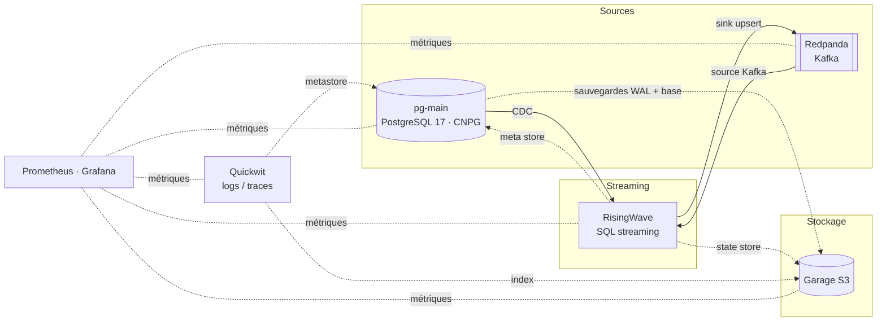

Le **Dagobah Data Lab** est un laboratoire local et auto-hébergé de plateforme de
données temps réel. Il couvre l'ingestion (CDC PostgreSQL, Redpanda/Kafka), le
traitement en streaming (RisingWave), le stockage (PostgreSQL CloudNativePG, S3
Garage), la recherche (Quickwit) et la supervision (Prometheus, Grafana). Le tout
tourne sur un cluster minikube à 3 nœuds, déclaré avec helmfile.

## Architecture

## Composants

| Domaine | Composant | Accès |
|---|---|---|
| Cluster | minikube 3 nœuds, Podman rootful, ingress-nginx, cert-manager | `make up`, `make verify` |
| Base de données | PostgreSQL 17 `pg-main` (CloudNativePG, 3 instances) | `pg-main-rw.databases:5432`, https://pgadmin.k8s.test |
| Stockage objet | Garage (S3, réplication ×3) | https://s3.k8s.test, https://garage.k8s.test |
| Streaming | Redpanda + Console | `redpanda.redpanda.svc:9093`, https://redpanda.k8s.test |
| SQL streaming | RisingWave (opérateur) | `make rw-psql`, https://risingwave.k8s.test |
| Recherche | Quickwit | https://quickwit.k8s.test |
| Supervision | Prometheus, Alertmanager, Grafana | https://grafana.k8s.test |
| Administration | Headlamp | https://headlamp.k8s.test |

Identifiants des interfaces : `make ui-credentials`.


Pour ouvrir les URL `https://*.k8s.test` sans alerte, la CA locale doit être
importée dans le navigateur : voir [08 — Certificats](installation/08-certificats-navigateur).


## Démarrer


  
  
  
  

