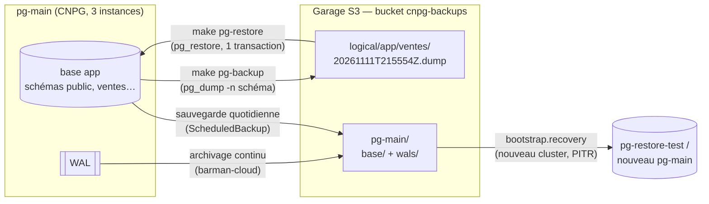
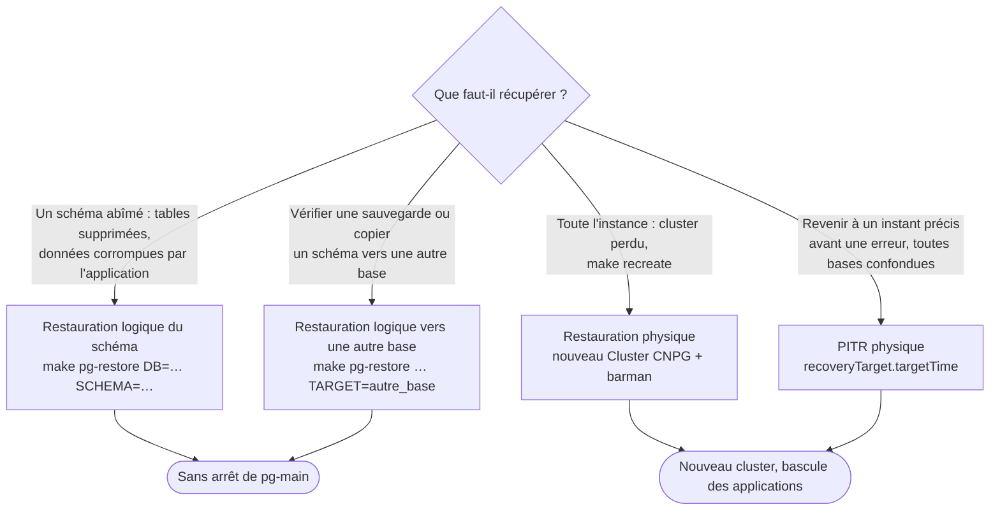
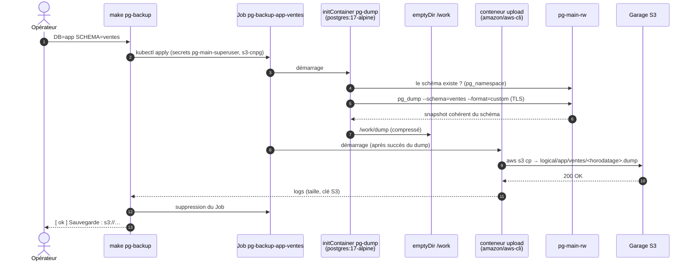
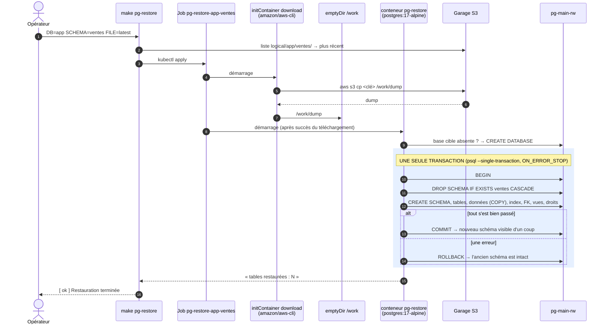
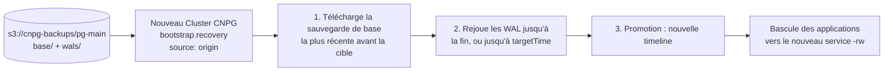

> [!NOTE]
> Mode opératoire testé le 2026-11-11 sur `pg-main` (PostgreSQL 17, CloudNativePG)
> et Garage S3 (bucket `cnpg-backups`).

Deux mécanismes complémentaires envoient les données de `pg-main` vers le S3
Garage, et permettent de les en ramener :

| | **Logique, par schéma** (ce guide) | **Physique, instance complète** ([étape 10](../../installation/10-sauvegardes-postgresql)) |
|---|---|---|
| Outil | `pg_dump` / `pg_restore` (format custom) | barman-cloud (plugin CNPG) |
| Granularité | **un schéma** d'une base | toute l'instance (toutes les bases) |
| Déclenchement | à la demande : `make pg-backup` | continu (WAL) + quotidien 02:00 |
| Restauration | dans la base d'origine **ou une autre base**, sans arrêt | **nouveau cluster** CNPG |
| Point de restauration | l'instant du dump | **n'importe quel instant** (PITR) |
| Emplacement S3 | `s3://cnpg-backups/logical/<base>/<schéma>/<horodatage>.dump` | `s3://cnpg-backups/pg-main/` |
| Cas d'usage | erreur applicative sur un schéma, copie vers une autre base, archivage, migration | perte de l'instance, `make recreate`, retour à un instant précis |

## Vue d'ensemble



### Quelle méthode choisir ?



## Sauvegarde logique d'un schéma

```bash
make pg-backup DB=app SCHEMA=ventes
```

```text
[info] Sauvegarde du schéma app.ventes -> s3://cnpg-backups/logical/app/ventes/20261111T215554Z.dump
pg_dump : 20.0K
tables avec données : 2
[ ok ] Sauvegarde : s3://cnpg-backups/logical/app/ventes/20261111T215554Z.dump
```

### Déroulement

Chaque sauvegarde est un **Job Kubernetes éphémère** dans le namespace
`databases`. Il ne s'exécute pas sur le poste local, donc rien ne transite par
la machine hôte.



Points clés :

- **Cohérence** : `pg_dump` travaille dans une transaction `REPEATABLE READ`. Le
  dump est cohérent même si l'application écrit en même temps, sans bloquer les
  lectures ni les écritures. Il prend seulement des verrous `ACCESS SHARE`, qui
  bloquent les `DROP` et `ALTER` concurrents.
- **Contenu** : tables, données, index, contraintes (clés étrangères incluses),
  vues, séquences, fonctions du schéma, **propriétaires et droits**.
- **Pas de transfert inutile** : l'upload ne démarre que si le dump a réussi
  (initContainer). Un dump en échec ne laisse donc aucun fichier partiel dans S3.

### Lister les sauvegardes

```bash
make pg-backups DB=app              # tous les schémas de la base app
make pg-backups DB=app SCHEMA=ventes
```

```text
2026-11-11 21:56:03      19521 logical/app/ventes/20261111T215554Z.dump
2026-11-11 22:00:07      19521 logical/app/ventes/20261111T220005Z.dump
```

Organisation dans le bucket :

```text
s3://cnpg-backups/
├── pg-main/                         ← barman (physique) : NE PAS modifier à la main
│   ├── base/<backup-id>/…
│   └── wals/…
└── logical/                         ← ce guide (pg_dump)
    └── app/                         ← base
        └── ventes/                  ← schéma
            ├── 20261111T215554Z.dump
            └── 20261111T220005Z.dump
```

## Restauration logique d'un schéma (S3 → PostgreSQL)

```bash
make pg-restore DB=app SCHEMA=ventes                            # dernière sauvegarde
make pg-restore DB=app SCHEMA=ventes FILE=20261111T215554Z.dump # sauvegarde précise
make pg-restore DB=app SCHEMA=ventes TARGET=app_verif           # dans une autre base (créée si besoin)
```

> [!WARNING]
> La restauration **remplace entièrement** le schéma dans la base cible
> (`DROP SCHEMA … CASCADE`, puis recréation). Tout ce qui a été écrit dans ce
> schéma depuis la sauvegarde est perdu. Les objets **d'autres schémas** qui en
> dépendent (vues, clés étrangères) sont aussi supprimés par le `CASCADE`. En cas
> de doute, restaurer d'abord dans une autre base avec `TARGET=…` et comparer.

### Déroulement



Pourquoi cet enchaînement :

- **Téléchargement d'abord** : si le fichier S3 est absent ou illisible, le Job
  échoue **avant** de toucher à la base.
- **Tout ou rien** : la suppression et la recréation sont dans la même
  transaction. Les applications voient l'ancien schéma jusqu'au `COMMIT`, puis le
  nouveau. Il n'y a jamais d'état intermédiaire et pas de schéma à moitié
  restauré.
- **Propriétaires conservés** : les rôles (`app`, …) existent dans le même
  cluster, donc les objets retrouvent leur propriétaire d'origine.

## Vérifications (tests du 2026-11-11)

Schéma de test `app.ventes` : 50 produits, 5 000 factures, une vue
`ca_par_produit`, une clé étrangère, propriétaire `app`.

| Test | Action | Résultat |
|---|---|---|
| 1. Sauvegarde | `make pg-backup DB=app SCHEMA=ventes` | dump de 19,5 Ko dans Garage, 2 tables avec données, ~14 s ✅ |
| 2. Incident puis restauration | `DROP TABLE ventes.factures` + suppression de 40 produits, puis `make pg-restore DB=app SCHEMA=ventes` | 50 produits, 5 000 factures, vue, FK et propriétaire `app` restaurés, CA identique au centime (974 452,87) ✅ |
| 3. Restauration vers une autre base | `… TARGET=app_verif` | base créée, 5 000 factures, même CA ; production intacte ✅ |
| 4. Atomicité | erreur injectée après le `DROP` et la recréation (`SELECT 1/0`) | psql sort en code 3, **ROLLBACK** : le schéma d'origine reste intact (5 000 factures) ✅ |

Contrôles utiles après une restauration :

```sql
-- nombre de lignes par table du schéma
SELECT relname, n_live_tup FROM pg_stat_user_tables WHERE schemaname = 'ventes';
-- propriétaires
SELECT tablename, tableowner FROM pg_tables WHERE schemaname = 'ventes';
-- contraintes
SELECT conname, contype FROM pg_constraint WHERE connamespace = 'ventes'::regnamespace;
```

## Restauration physique (instance complète, PITR)

Quand c'est **toute l'instance** qu'il faut récupérer (cluster perdu,
`make recreate`, retour à un instant précis), on utilise les sauvegardes
physiques barman. La procédure détaillée et testée est dans
[l'étape 10](../../installation/10-sauvegardes-postgresql#restauration-testée-le-2026-11-11).



```yaml
bootstrap:
  recovery:
    source: origin
    recoveryTarget:
      targetTime: "2026-11-11 21:50:00+00"   # optionnel : sinon, jusqu'au dernier WAL archivé
externalClusters:
  - name: origin
    plugin:
      name: barman-cloud.cloudnative-pg.io
      parameters: {barmanObjectName: pg-main-backups, serverName: pg-main}
```

On peut aussi **combiner** les deux méthodes. Par exemple, restaurer l'instance à
un instant donné dans un cluster temporaire, en extraire un seul schéma avec
`pg_dump -n`, puis le restaurer dans `pg-main` avec ce guide.

## Pièges et limites

- **Même version majeure** : le dump est fait avec `pg_dump` 17
  (`postgres:17-alpine`), comme pg-main. Un `pg_dump` plus ancien que le serveur
  refuse de fonctionner. Pour restaurer vers une version plus récente, c'est
  possible.
- **Ce que `-n schéma` n'emporte pas** : les **rôles** (globaux au cluster), les
  **extensions** créées dans un autre schéma, les *large objects*, les objets
  d'autres schémas qui référencent celui-ci. Pour une base entière, utiliser
  plutôt `pg_dump` sans `-n`, ou la méthode physique.
- **Dépendances inter-schémas** : le `DROP SCHEMA … CASCADE` supprime aussi les
  vues et les clés étrangères des **autres** schémas qui pointent vers le schéma
  restauré, et ces objets ne sont pas recréés. Vérifier avant avec :
  `SELECT * FROM pg_depend` ou en restaurant d'abord dans une base de test.
- **CDC vers RisingWave** ([étape 13](../../installation/13-cdc-pg-main-risingwave)) :
  la réplication logique ne transmet **pas** les DDL. Si un schéma contenant des
  tables répliquées est restauré, le `DROP` n'est pas propagé, et les données
  rechargées arrivent comme des `INSERT`. Il faut alors recréer les tables CDC
  côté RisingWave. Le schéma `ventes` de démonstration n'est pas répliqué.
- **Restauration sur le primaire** : le Job vise `pg-main-rw`. Les réplicas
  reçoivent la restauration par la réplication physique, sans action.
- **Rétention** : les dumps logiques **ne sont pas purgés automatiquement**,
  contrairement aux sauvegardes barman (14 jours). Les supprimer avec
  garage-webui (https://garage.k8s.test, bucket `cnpg-backups`, dossier `logical/`).
- **Volumétrie** : le dump transite par un volume `emptyDir` du pod, donc sur le
  disque du nœud. Pour un très gros schéma, prévoir l'espace, ou passer en
  streaming (`pg_dump | aws s3 cp - s3://…`).
- **Test à ne pas reproduire** : enchaîner `DROP SCHEMA` et `pg_dump` du même
  schéma dans **une même** transaction crée un interblocage. `pg_dump` attend le
  verrou que tient la transaction. Le script évite ce piège : le fichier est
  téléchargé **avant** l'ouverture de la transaction.

## Référence

| Élément | Valeur |
|---|---|
| Script | `deploy/k8s/scripts/pg-schema-backup.sh` (`backup`, `list`, `restore`) |
| Cibles make | `pg-backup`, `pg-backups`, `pg-restore` (variables `DB`, `SCHEMA`, `FILE`, `TARGET`) |
| Images | `postgres:17-alpine`, `amazon/aws-cli:2.40.1` |
| Secrets | `databases/pg-main-superuser` (PostgreSQL), `databases/s3-cnpg` (S3) |
| S3 | `http://garage.garage.svc:3900`, région `garage`, `AWS_REQUEST_CHECKSUM_CALCULATION=when_required` (sinon Garage répond `Invalid payload signature`) |

Pistes : planifier les sauvegardes logiques avec un `CronJob`, et purger
automatiquement les anciens dumps (règle de cycle de vie S3 ou script).
